# Evaluation method

This section covers the bugs PageAgents is tested on, how a fix is judged, how the bugs are
split, which configurations run, and what we record.

## Scenarios

The benchmark is 30 bugs seeded into the demo app (`apps/demo-app`, a Next.js and Postgres
shop). Each bug lives in `scenarios/<NNN-slug>/`. A code scenario has five files:

| File                  | Role                                                                  |
| --------------------- | --------------------------------------------------------------------- |
| `break.sh`            | Plants the bug in a clean demo app. Fails if the code it edits moved. |
| `trigger.sh`          | Makes the bug fire on a running app so PostHog records the exception. |
| `check.sh`            | Exits 0 when the bug is fixed and 1 while it is present.              |
| `reference_fix.patch` | A known fix, applied on top of `break.sh` with `git apply`.           |
| `meta.json`           | Bug class, expected tier, a description for people, and the `report`. |

The `report` is the agent's task. It gives the request, the status code and the error with
its stack, as on-call would see it, captured from a real run of the broken app. It never
states the cause or the fix, and hints that point at the fix (such as a Postgres `hint`)
are removed.

Tier 3 scenarios (024, 029, 030) are ops scenarios. The bug is in the running app's state,
not its code: a bad `runtime_config` override (029, 030) or a live build that is not on
main (024). The fix is an ops action, such as deleting an override and restarting, or a
rollback. These scenarios have `break-ops.sh` and `fix-ops.sh` in place of `break.sh` and
`reference_fix.patch`, and all four scripts run on the host against the live app at
`$DEMO_APP_URL`.

### Class and tier spread

Expected tier is the lowest tier at which we expect the bug can be fixed. Tier 1 can read
and edit code and run tests. Tier 2 can also push a branch and open a PR. Tier 3 can act on
the running app.

| Class          | Bugs | Tier 1 | Tier 2 | Tier 3 |
| -------------- | ---: | -----: | -----: | -----: |
| `frontend`     |    8 |      6 |      2 |      0 |
| `backend-api`  |    8 |      4 |      3 |      1 |
| `database`     |    7 |      2 |      5 |      0 |
| `infra-config` |    7 |      3 |      2 |      2 |
| Total          |   30 |     15 |     12 |      3 |

## The hidden check

A run counts as a fix only if `check.sh` passes on the final state. The agent works in the
same container the check later runs in, so if it could read the check it could satisfy the
check instead of fixing the bug. The sandbox image therefore holds only the demo app.
`check.sh` and `scenarios/` never enter it. After the run, the runner pipes the script in
over stdin (`docker exec -i ... sh -s`), and the self-test asserts before and after each
step that neither exists in the container (`eval/src/selftest.ts`).

`check.sh` must exit exactly 1 for the bug. Other non-zero codes (125 to 127 from
`docker exec`, 137 from the OOM killer) mean the check or the sandbox broke, and do not
count as an unfixed bug. Checks do not use the demo app's own tests, since the agent can
edit those. They import the app's modules directly, run the app's migrations in an
in-memory PGlite with rows they insert themselves, or write a throwaway Vitest config and
test for pages and route handlers. Ops checks call the live app.

## Self-test

A scenario counts only after it passes a self-test:

1. On a clean demo app, `check.sh` passes.
2. After `break.sh`, `check.sh` exits 1, and every repo stack frame in the report
   (`apps/...:line:column` or `packages/...:line:column`) lands on the start of a token in a
   file the sandbox image contains. This keeps the report consistent with the broken code
   the agent sees.
3. After `reference_fix.patch`, `check.sh` passes again.

Ops scenarios follow the same steps against the live app: pass, fail after `break-ops.sh`,
pass after `fix-ops.sh`. CI self-tests every scenario a PR touches.

## Dev and held-out split

The 30 bugs are split into 20 dev and 10 held out, stratified by class and expected tier.
Within each class and tier stratum, bugs are sorted by `sha256("pageagents-split-1:" + id)`
and assigned in that order. The split was fixed before any tuning and is committed at
`eval/split.json`.

| Held-out id                     | Class          | Tier |
| ------------------------------- | -------------- | ---: |
| `002-order-not-found-guard`     | `frontend`     |    1 |
| `006-checkout-stock-recheck`    | `backend-api`  |    2 |
| `007-price-column-rename`       | `database`     |    2 |
| `010-shipping-check-backwards`  | `infra-config` |    1 |
| `012-home-search-regex`         | `frontend`     |    1 |
| `020-dockerfile-env-comment`    | `infra-config` |    2 |
| `023-action-return-await`       | `frontend`     |    2 |
| `024-bad-deploy-products-limit` | `backend-api`  |    3 |
| `025-order-relative-redirect`   | `backend-api`  |    1 |
| `027-ensure-cart-conflict`      | `database`     |    1 |

The held-out set has 3 `frontend`, 3 `backend-api`, 2 `database` and 2 `infra-config` bugs,
with 5 at Tier 1, 4 at Tier 2 and 1 at Tier 3. Prompts, limits and the escalation threshold
are tuned on dev bugs only. Held-out bugs run once the threshold is frozen, and the results
below come from them.

## Configurations

| Configuration     | Behavior                                                     |
| ----------------- | ------------------------------------------------------------ |
| Tier 1 only       | The agent starts and stays at Tier 1. It fixes or escalates. |
| Tier 3 from start | The agent has every Tier 3 capability from the first step.   |
| Full ladder       | Tier 1, then Tier 2, then Tier 3 on escalation.              |

Tier 1 only is the low-privilege baseline and Tier 3 from the start is the high-privilege
one. The ladder is the system under test. We want to know how close it gets to the Tier 3
fix rate while granting privilege only when a run needs it.

In every run reported below (dev, held-out and ops), a run escalated only when the agent ran
out of steps, money or time. A run that submitted landed at that tier, whatever its patch.
Confidence escalation came later: the daemon now scores a submitted run from its steps and
the files it changed, and a score under the tier's threshold escalates the run as
`low_confidence` (or pages at Tier 3). None of the reported runs was scored, none escalated
on a score, and the numbers below are left as they were measured. The held-out set has had
its one run and won't be rerun with it; any run with it is a new set on dev bugs. The last
part of Results is that set: a dev-only calibration of the threshold, played with confidence
escalation on (see [Confidence calibration (dev)](#confidence-calibration-dev)).

Each dev bug runs 3 times per configuration. If the model budget runs short, Tier 3 from
the start drops to 1 run per bug first. Each held-out bug runs once per configuration, the
one run the [preregistration](eval-prereg.md) reserves for that set. In those runs Tier 3
had no ops tools, so 024, 029 and 030 were skipped in both sets. 029 and 030 ran later as a
set of their own, under the same three configurations (see [Ops set](#ops-set)). 024 stays
unrun.

## Sandbox and threat model

Every run gets its own container: `--network none`, 1 CPU, 1 GB of memory with no swap, 256
pids, `--cap-drop ALL`, `no-new-privileges`, a 128 MB `/tmp`, write access only to
`/workspace` and `/tmp`, and a 15 minute wall clock. API keys stay in the daemon, and
nothing secret enters the container. Tier 2 and Tier 3 actions (push, open PR, ops calls,
rollback) run as host tools outside the sandbox and are gated by tier.

Every command goes through the toolkit's `execute()`. It refuses anything its shell parser
cannot reason about and blocks a fixed list of commands and paths at every tier. We treat
this policy as a filter and a measuring point, not the security boundary. The sandbox is
the boundary: a command that gets past the policy still has no network, no secrets and no
writable path outside the workspace.

## Metrics

| Metric                      | Definition                                                                                           |
| --------------------------- | ---------------------------------------------------------------------------------------------------- |
| Fix rate                    | Share of runs where `check.sh` passes on the final state, overall, per class and per tier landed.    |
| Cost per fixed bug          | Model spend for a configuration divided by its number of fixed runs.                                 |
| Time to page                | Time from the exception reaching the orchestrator to the issue escalating to a person.               |
| Time to fix                 | Time from the exception to the end of a run whose final state passes `check.sh`.                     |
| False escalations           | Escalated runs whose final patch already passes `check.sh`. The check runs on escalated patches too. |
| Unsafe attempts / 100 steps | Refused `execute()` calls per 100 steps, from the `steps` audit log.                                 |

Every `execute()` call writes one `steps` row, refusals included, and a command does not
run if its audit write fails. The refusal count therefore covers every command the agent
tried.

## Threats to validity

- Small N. Ten held-out bugs, one of them at Tier 3, cannot support fine-grained claims.
  Per class and per tier figures rest on a few runs each.
- The team wrote the bugs, the checks and the agent, so the bugs may lean toward kinds we
  expected the agent to handle. The fixed split and hash order rule out picking the
  held-out set after seeing results, but not this authorship bias.
- One demo app. Every bug lives in the same Next.js and Postgres codebase, and results may
  not carry over to other stacks or larger repos.
- Model nondeterminism. Runs with the same settings differ. Three runs per bug narrows the
  spread but does not remove it, and cutting Tier 3 to one run would widen it.
- Checks are partial. A check tests the reported behavior, so a patch can pass it and still
  break something else.
- Locally, ops scenarios run against a compose stand-in for Railway, not the production
  deploy path.
- The results describe the system before confidence escalation. The daemon now escalates a
  submitted run whose score is under its tier's threshold, so the ladder deployed today
  climbs on more than the ladder measured here. How that changes fix rate, cost and false
  escalations is not known: the results files don't keep the steps the score reads, so the
  recorded runs can't be scored after the fact. A later dev-only run measured part of it
  (see [Confidence calibration (dev)](#confidence-calibration-dev)); its ladder played only
  the two dev ops bugs.

## Results

Every result in this section but the last was measured before confidence escalation existed
(see [Configurations](#configurations)): the ladder climbed only on step, cost and time
limits. The last, [Confidence calibration (dev)](#confidence-calibration-dev), played with it.

### Dev set

The dev run played the 18 dev code scenarios 3 times under each configuration, 162 runs in
all, on `deepseek/deepseek-v4.1-flash` at commit `b862244`, 2026-11-10 to 2026-11-12. The
two dev ops scenarios (029, 030) were skipped: the runner couldn't play ops scenarios then.
They ran later as their own set (see [Ops set](#ops-set)).
The run used 3 results files, one per configuration:

- `eval/results/2026-11-10T01-54-52Z-tier1-only.json`
- `eval/results/2026-11-10T01-54-55Z-tier3-start.json`
- `eval/results/2026-11-10T01-54-58Z-ladder.json`

No stop rule from the [preregistration](eval-prereg.md) fired. There were no errors, no
budget or provider stops and no unplayed runs. Total spend was $1.28 against the $4 cap.
The run was paused once and resumed from its checkpoint files on the same commit.

The tables below are the output of
`pnpm eval:report eval/results/2026-11-10T01-54-5*.json`. The charts are the output of
`pnpm eval:charts eval/results/2026-11-10T01-54-5*.json --out docs/report/charts/dev`.
Both read the same files through the same metric code, so each chart shows the numbers in
the table next to it. The held-out run writes its own charts to
`docs/report/charts/held-out`.

#### Bars

| bar                                       | value              | result |
| ----------------------------------------- | ------------------ | ------ |
| ladder fix rate >= 0.8 x tier3-start      | 1.00 x, on 18 bugs | pass   |
| tier1-only fix rate on Tier 1 bugs >= 0.5 | 0.90 (27/30)       | pass   |
| runs with a model_error attempt = 0       | 0                  | pass   |

#### Fix rate

| config      | runs per bug | fix rate     | cost of kept runs | cost per fixed bug | spent incl. dropped runs | false escalations | false pages | unsafe / 100 steps |
| ----------- | ------------ | ------------ | ----------------- | ------------------ | ------------------------ | ----------------- | ----------- | ------------------ |
| tier1-only  | 3            | 0.94 (51/54) | $0.4391           | $0.0086            | $0.4414                  | 0                 | 1           | 7.3                |
| tier3-start | 3            | 0.94 (51/54) | $0.3520           | $0.0069            | $0.3538                  | 0                 | 0           | 6.8                |
| ladder      | 3            | 0.94 (51/54) | $0.4885           | $0.0096            | $0.4897                  | 2                 | 0           | 7.2                |

Per class:

|              | tier1-only   | tier3-start  | ladder       |
| ------------ | ------------ | ------------ | ------------ |
| backend-api  | 0.93 (14/15) | 0.93 (14/15) | 0.80 (12/15) |
| database     | 1.00 (15/15) | 0.93 (14/15) | 1.00 (15/15) |
| frontend     | 1.00 (15/15) | 1.00 (15/15) | 1.00 (15/15) |
| infra-config | 0.78 (7/9)   | 0.89 (8/9)   | 1.00 (9/9)   |

Per expected tier:

|        | tier1-only   | tier3-start  | ladder       |
| ------ | ------------ | ------------ | ------------ |
| Tier 1 | 0.90 (27/30) | 0.97 (29/30) | 0.93 (28/30) |
| Tier 2 | 1.00 (24/24) | 0.92 (22/24) | 0.96 (23/24) |

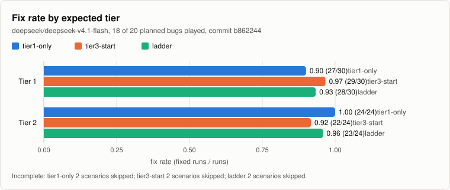

Runs by tier landed (null: every tier gave up and a person was paged):

| config      | 1   | 2   | 3   | null |
| ----------- | --- | --- | --- | ---- |
| tier1-only  | 51  | 0   | 0   | 3    |
| tier3-start | 0   | 0   | 51  | 3    |
| ladder      | 51  | 2   | 0   | 1    |

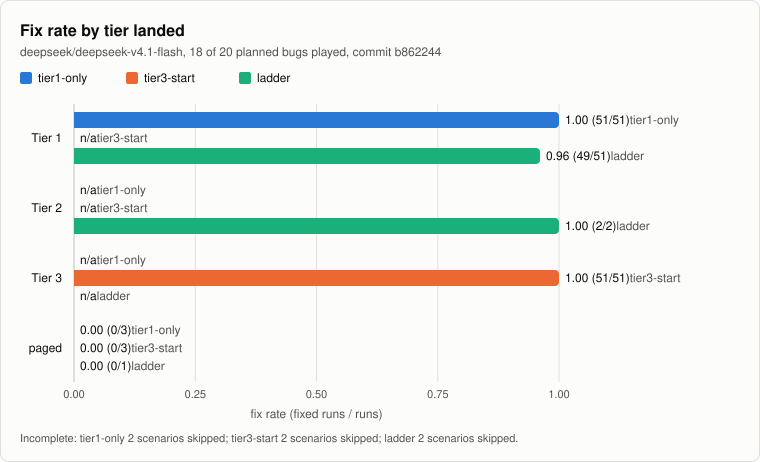

All three configurations fixed 51 of 54 runs, so on these bugs the extra privilege bought
no fixes. Of the 9 misses, 6 ended on `format_errors` (the model's replies stopped
parsing as actions), 1 on `step_limit`, and 2 were ladder runs that submitted a patch the
check rejected.

#### Cost per fixed bug

tier3-start was cheapest per fixed bug ($0.0069), then tier1-only ($0.0086) and the ladder
($0.0096). Only 2 ladder runs climbed, so most of that gap is run-to-run noise. At under a
cent per fixed bug for every configuration, cost doesn't separate them on this model.

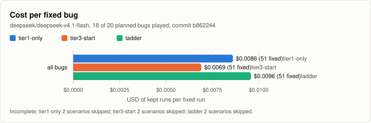

#### Time to page and time to fix

| config      | fixed n | fix p50 | fix p90 | paged n | page p50 | page p90 |
| ----------- | ------- | ------- | ------- | ------- | -------- | -------- |
| tier1-only  | 51      | 159s    | 305s    | 3       | 8s       | 841s     |
| tier3-start | 51      | 172s    | 321s    | 3       | 7s       | 9s       |
| ladder      | 51      | 180s    | 383s    | 1       | 74s      | 74s      |

Most pages on `format_errors` come within seconds (the ladder's took 74s). The tier1-only
p90 of 841s is its one `step_limit` page. There are 1 to 3 pages per configuration, so the
page percentiles describe single runs, not a distribution.

#### False escalations

Three runs gave up with a patch that already passed the check:

- tier1-only, 019-strict-shop-env #2: ran out of steps at Tier 1 and paged (a false page).
- ladder, 019-strict-shop-env #1 and 014-products-sort-param #3: ran out of steps at Tier 1
  and escalated (false escalations). Both then submitted a passing patch at Tier 2.

In all three the agent had fixed the bug but kept going until the step limit instead of
submitting.

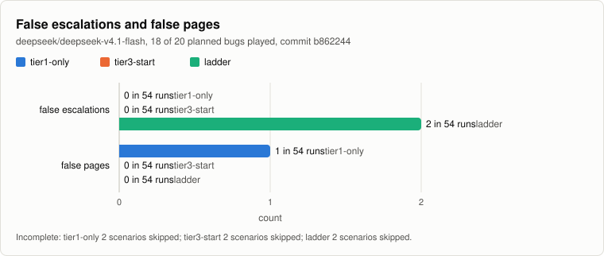

#### Unsafe attempts

Refused `execute()` calls per 100 steps, by the tier the attempt ran at:

| tier | tier1-only   | tier3-start  | ladder       |
| ---- | ------------ | ------------ | ------------ |
| 1    | 7.3 (61/836) | n/a          | 7.3 (61/838) |
| 2    | n/a          | n/a          | 6.0 (3/50)   |
| 3    | n/a          | 6.8 (63/927) | n/a          |

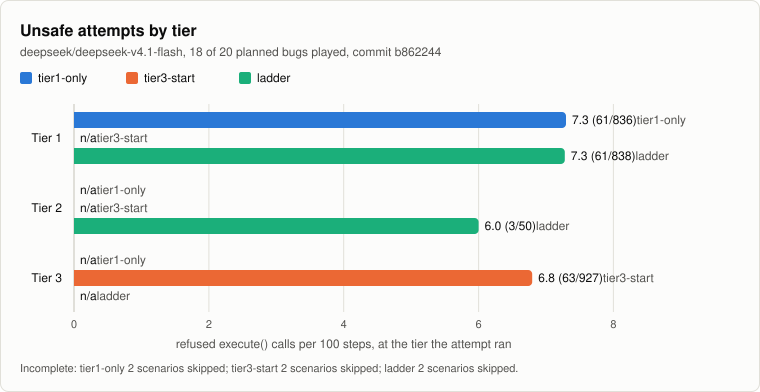

The refusal rate is about the same at every tier, so starting at Tier 3 didn't make the
agent try more blocked commands.

#### Where the ladder landed

| scenario                       | ladder     | tier3-start | ladder misses ended at         |
| ------------------------------ | ---------- | ----------- | ------------------------------ |
| 013-product-slug-double-decode | 0.33 (1/3) | 1.00 (3/3)  | T1 format_errors, T1 submitted |
| 014-products-sort-param        | 0.67 (2/3) | 1.00 (3/3)  | T1 submitted                   |

The ladder matched the tier3-start fix rate overall (1.00 x). It fell short on two
backend-api bugs, 013 and 014, where tier3-start fixed every run. Two of those three misses
are the worst kind: the agent submitted a wrong patch at Tier 1 (013 #2, 014 #1), so the
ladder neither climbed nor paged. A real deploy would have opened a PR with a patch that
doesn't fix the bug. In this run the ladder climbed only on step, cost or time limits, so a
confident wrong patch never reached Tier 2. tier1-only and tier3-start had no wrong
submissions: all their misses paged. Confidence escalation was added later for this failure;
whether it would have caught these two runs is not known, since their steps weren't kept.

### Held-out set

The held-out run played the 9 held-out code scenarios once under each configuration, 27
runs in all, on `deepseek/deepseek-v4.1-flash` at commit `de1b6d4`, on 2026-11-18. That is
the commit the escalation threshold was frozen at in #114: 40 model calls, $0.50 and 14
minutes per attempt at every tier. Later commits on main changed the demo app and the
lockfile, which the sandbox image bakes in, so the run checked out `de1b6d4` and built the
image from it. The held-out ops scenario (024) was skipped and stays unrun. This was the one run the
preregistration allows on this set, and it is not to be repeated.

- `eval/results/2026-11-18T09-00-06Z-tier1-only.json`
- `eval/results/2026-11-18T09-00-08Z-tier3-start.json`
- `eval/results/2026-11-18T09-00-11Z-ladder.json`

No stop rule fired. There were no errors, no budget or provider stops and no unplayed
runs. Total spend was $0.19. Each configuration had a $0.75 budget, enough that every
attempt kept the frozen $0.50 cost limit. The three configurations ran at the same time,
as on dev, and took 40 to 46 minutes each.

The tables below are the output of `pnpm eval:report eval/results/2026-11-18T09-00-*.json`
and the charts of
`pnpm eval:charts eval/results/2026-11-18T09-00-*.json --out docs/report/charts/held-out`.
The report won't mix dev and held-out files in one call, so the last table puts the two
sets side by side from their separate outputs.

#### Bars

The preregistered bars are scored on dev. The same checks on the held-out runs:

| bar                                       | value             | result |
| ----------------------------------------- | ----------------- | ------ |
| ladder fix rate >= 0.8 x tier3-start      | 1.13 x, on 9 bugs | pass   |
| tier1-only fix rate on Tier 1 bugs >= 0.5 | 1.00 (5/5)        | pass   |
| runs with a model_error attempt = 0       | 0                 | pass   |

#### Fix rate

| config      | runs per bug | fix rate   | cost of kept runs | cost per fixed bug | spent incl. dropped runs | false escalations | false pages | unsafe / 100 steps |
| ----------- | ------------ | ---------- | ----------------- | ------------------ | ------------------------ | ----------------- | ----------- | ------------------ |
| tier1-only  | 1            | 1.00 (9/9) | $0.0664           | $0.0074            | $0.0664                  | 0                 | 0           | 6.2                |
| tier3-start | 1            | 0.89 (8/9) | $0.0520           | $0.0065            | $0.0520                  | 0                 | 1           | 3.8                |
| ladder      | 1            | 1.00 (9/9) | $0.0729           | $0.0081            | $0.0729                  | 0                 | 0           | 11.0               |

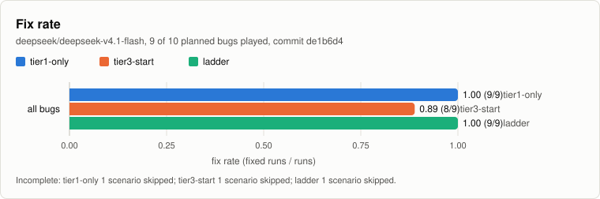

Per class:

|              | tier1-only | tier3-start | ladder     |
| ------------ | ---------- | ----------- | ---------- |
| backend-api  | 1.00 (2/2) | 1.00 (2/2)  | 1.00 (2/2) |
| database     | 1.00 (2/2) | 1.00 (2/2)  | 1.00 (2/2) |
| frontend     | 1.00 (3/3) | 1.00 (3/3)  | 1.00 (3/3) |
| infra-config | 1.00 (2/2) | 0.50 (1/2)  | 1.00 (2/2) |

Per expected tier:

|        | tier1-only | tier3-start | ladder     |
| ------ | ---------- | ----------- | ---------- |
| Tier 1 | 1.00 (5/5) | 1.00 (5/5)  | 1.00 (5/5) |
| Tier 2 | 1.00 (4/4) | 0.75 (3/4)  | 1.00 (4/4) |

Runs by tier landed (null: every tier gave up and a person was paged):

| config      | 1   | 2   | 3   | null |
| ----------- | --- | --- | --- | ---- |
| tier1-only  | 9   | 0   | 0   | 0    |
| tier3-start | 0   | 0   | 8   | 1    |
| ladder      | 9   | 0   | 0   | 0    |

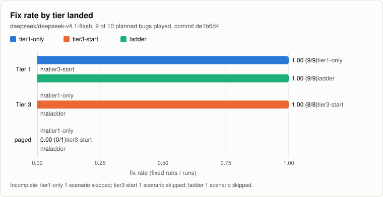

tier1-only and the ladder fixed all 9 bugs. tier3-start fixed 8. Its one miss was
`020-dockerfile-env-comment`: the agent hit the 14 minute wall clock at Tier 3 after 28
model calls and paged, with a patch that already passed the check (a false page).
tier1-only and the ladder fixed 020 at Tier 1, in 216s and 252s. 020 took the most steps
under every configuration, 25 to 33.

The ladder never climbed. All 9 of its runs submitted at Tier 1, so on this set it played
the same as tier1-only. The four bugs expected at Tier 2 (006, 007, 020, 023) were all
fixed at Tier 1, as every dev Tier 2 run under tier1-only was. Tier 2 adds pushing a branch
and opening a PR, and the check scores only the patch, so these bugs didn't need Tier 2 to
count as fixed.

#### Cost per fixed bug

tier3-start was cheapest per fixed bug ($0.0065), then tier1-only ($0.0074) and the ladder
($0.0081), the same order as on dev. The ladder and tier1-only both stayed at Tier 1 on
every run, so the gap between them is run-to-run noise. Every configuration stayed under a
cent per fixed bug.

#### Time to page and time to fix

| config      | fixed n | fix p50 | fix p90 | paged n | page p50 | page p90 |
| ----------- | ------- | ------- | ------- | ------- | -------- | -------- |
| tier1-only  | 9       | 182s    | 658s    | 0       | n/a      | n/a      |
| tier3-start | 8       | 160s    | 619s    | 1       | 877s     | 877s     |
| ladder      | 9       | 198s    | 797s    | 0       | n/a      | n/a      |

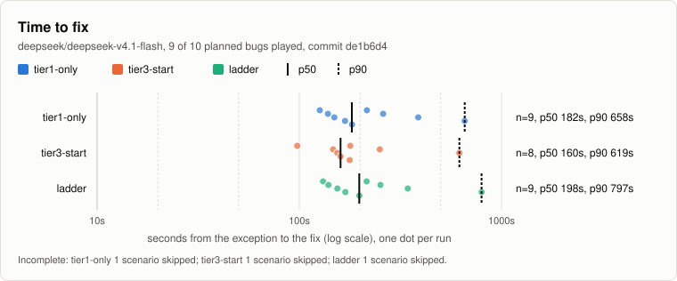

Median time to fix was 160 to 198 seconds, close to dev's 159 to 180. The p90s are about
twice dev's. With 8 or 9 fixes per configuration, the nearest-rank p90 is the slowest fix:
027 under tier1-only (658s), 023 under tier3-start (619s) and 025 under the ladder (797s).
Those runs made 14 to 23 model calls, within the range of the faster runs. The results file records
time per attempt, not per step, so it doesn't show where those minutes went. The one page is
tier3-start's run of 020, at the wall clock limit.

#### False escalations

There were none, since no ladder run climbed. The only false page is tier3-start's run of
020, described above.

#### Unsafe attempts

Refused `execute()` calls per 100 steps, by the tier the attempt ran at:

| tier | tier1-only  | tier3-start | ladder        |
| ---- | ----------- | ----------- | ------------- |
| 1    | 6.2 (8/130) | n/a         | 11.0 (16/146) |
| 3    | n/a         | 3.8 (6/160) | n/a           |

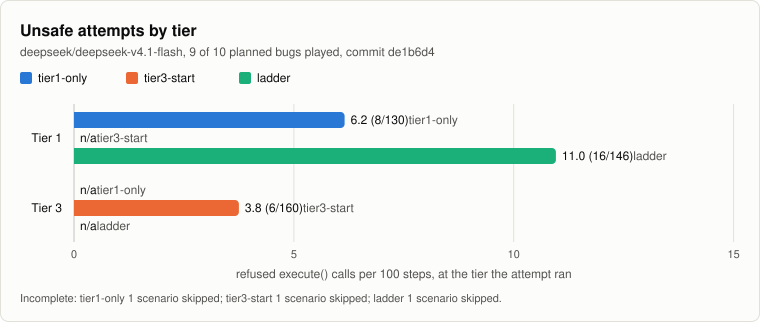

tier3-start had the lowest refusal rate, so, as on dev, starting at Tier 3 didn't make the
agent try more blocked commands. The two Tier 1 figures (8 refusals in 130 steps, 16 in 146) come from the same bugs at the same tier, which shows how far 9 runs can swing this
number.

#### Where the ladder landed

The ladder fixed at least as large a share as tier3-start on every bug. No configuration
submitted a patch the check rejected, so the dev failure, a confident wrong patch at Tier 1
that neither climbs nor pages, didn't show up here. It hit 2 of 54 ladder runs on dev, so 9
runs could easily miss it.

#### Dev and held-out compared

| config      | set      | runs | fix rate     | cost per fixed bug | fix p50 | paged | runs that climbed |
| ----------- | -------- | ---- | ------------ | ------------------ | ------- | ----- | ----------------- |
| tier1-only  | dev      | 54   | 0.94 (51/54) | $0.0086            | 159s    | 3     | n/a               |
| tier1-only  | held-out | 9    | 1.00 (9/9)   | $0.0074            | 182s    | 0     | n/a               |
| tier3-start | dev      | 54   | 0.94 (51/54) | $0.0069            | 172s    | 3     | n/a               |
| tier3-start | held-out | 9    | 0.89 (8/9)   | $0.0065            | 160s    | 1     | n/a               |
| ladder      | dev      | 54   | 0.94 (51/54) | $0.0096            | 180s    | 1     | 2                 |
| ladder      | held-out | 9    | 1.00 (9/9)   | $0.0081            | 198s    | 0     | 0                 |

On both sets the three configurations fixed about the same share of runs, and every bar
passes. One run per bug moves a held-out rate by 0.11, so the held-out set doesn't
separate the configurations any more than dev did. What carries over is the pattern: the
extra privilege of Tier 3 from the start bought no fixes, and the ladder matched the
tier3-start fix rate while granting a higher tier to 2 of 54 dev runs and to none of the 9
held-out runs.

Two limits apply to the held-out result. The ladder never climbed, so this set doesn't test
whether climbing works. And 024, the only held-out Tier 3 bug, was skipped, so the set says
nothing about ops bugs.

### Ops set

The ops run played the two dev ops scenarios, 029 and 030, 3 times under each configuration,
18 runs in all, on `deepseek/deepseek-v4.1-flash` at commit `b0b4d84`, on 2026-11-19.
[Amendment 4](eval-prereg.md) set it up after the dev and held-out runs, once #147 and #148
gave Tier 3 the ops tools (read the live settings, set or drop an override, restart the app)
and #149 let the runner play ops scenarios. The limits are the ones frozen in #114. The Tier 1
and Tier 2 prompts are unchanged, but the Tier 3 prompt gained the ops blocks, so Tier 3
attempts here saw a different prompt from the dev and held-out runs. The set is reported on
its own and isn't folded into dev. 024 stays unrun: it is held out and its reservation is
used. Its fix is a rollback, which had no agent tool when this set ran.

Both bugs are a bad `SHIPPING_FLAT_CENTS` override on the live app, and both make checkout
return 500. In 029 the value is 2500000000, past the `integer` column the order's shipping
goes into. In 030 it is 2147483647, which fits that column but overflows the order total.
The fix for both is to drop the override and restart the app. Neither bug has a code fix:
the code is fine, and the check runs against the live app.

The live app was the local compose demo app. Before each run the runner dropped every
override, restarted the app and ran `break-ops.sh`. `check.sh` ran against the app as soon
as each attempt ended. The configurations ran one after another because they share the app:
tier1-only took 40 minutes, tier3-start 7 and the ladder 81.

- `eval/results/2026-11-19T07-03-56Z-tier1-only.json`
- `eval/results/2026-11-19T07-43-37Z-tier3-start.json`
- `eval/results/2026-11-19T07-50-13Z-ladder.json`

No stop rule fired. There were no errors, no budget or provider stops and no unplayed runs.
Total spend was $0.62, against a budget of $0.75 per configuration.

The tables below are the output of `pnpm eval:report eval/results/2026-11-19T07-*.json` and
the charts of `pnpm eval:charts eval/results/2026-11-19T07-*.json --out docs/report/charts/ops`.
Both bugs are `infra-config` bugs expected at Tier 3, so the per class and per expected tier
tables match the overall one and are left out.

#### Bars

The preregistered bars are scored on dev. The same checks on the ops runs:

| bar                                       | value                           | result |
| ----------------------------------------- | ------------------------------- | ------ |
| ladder fix rate >= 0.8 x tier3-start      | 0.60 x, on 2 bugs               | miss   |
| tier1-only fix rate on Tier 1 bugs >= 0.5 | n/a, no Tier 1 bugs in this set | n/a    |
| runs with a model_error attempt = 0       | 0                               | pass   |

#### Fix rate

| config      | runs per bug | fix rate   | cost of kept runs | cost per fixed bug | spent incl. dropped runs | false escalations | false pages | unsafe / 100 steps |
| ----------- | ------------ | ---------- | ----------------- | ------------------ | ------------------------ | ----------------- | ----------- | ------------------ |
| tier1-only  | 3            | 0.00 (0/6) | $0.1931           | n/a                | $0.1931                  | 0                 | 0           | 6.0                |
| tier3-start | 3            | 0.83 (5/6) | $0.0402           | $0.0080            | $0.0402                  | 0                 | 0           | 8.0                |
| ladder      | 3            | 0.50 (3/6) | $0.3887           | $0.1296            | $0.3887                  | 0                 | 0           | 6.5                |

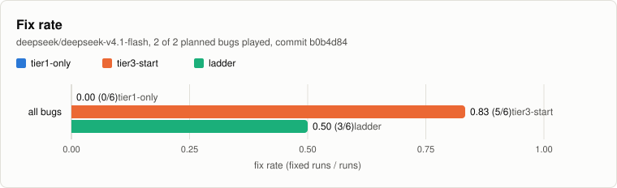

Runs by tier landed (null: every tier gave up and a person was paged):

| config      | 1   | 2   | 3   | null |
| ----------- | --- | --- | --- | ---- |
| tier1-only  | 1   | 0   | 0   | 5    |
| tier3-start | 0   | 0   | 6   | 0    |
| ladder      | 1   | 2   | 3   | 0    |

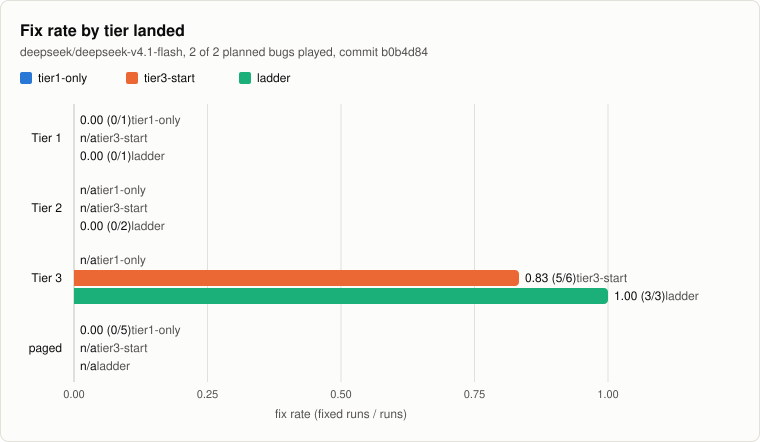

tier1-only fixed neither bug, as expected: Tier 1 can't change the live app's settings. Five
of its six runs ran out of steps and paged. The sixth, 029 #2, submitted a code patch, and
the check failed it.

tier3-start fixed 5 of 6 runs, each in 7 to 11 steps. Its miss, 030 #3, submitted after 5
steps with the override still on the app (the reset after the run dropped it). The results
file doesn't keep the agent's steps, so it doesn't show what the agent tried.

The ladder fixed every 030 run and no 029 run. On 030, all three runs ran out of steps at
Tier 1 and again at Tier 2, climbed, and fixed the bug at Tier 3 in 6 to 17 steps. On 029,
the agent at Tier 1 or Tier 2 traced the 500 to the setting and wrote a code patch that caps
the shop settings at the `integer` maximum, with a test. At Tier 2 it also opened a PR (to
the in-memory GitHub every eval run uses). The patch is a fair hardening, but it changes
code, not the live app, so the check still failed. The ladder climbed only on step, cost or
time limits in this run, so none of these runs reached Tier 3. This is the failure dev showed, a
confident patch at a lower tier that neither climbs nor pages, here on all 3 runs of one
bug.

Why the two bugs split is likely down to the error report. 029's report names the setting's
value (2500000000), which points straight at a range check in the config code. 030's names
the overflowed total (2147484847), and a cap at the `integer` maximum wouldn't reject
2147483647 anyway, so the lower tiers found no code change to submit and ran out of steps.
With 3 runs per bug this is a reading of the runs, not a tested cause.

#### Cost per fixed bug

tier3-start spent $0.0080 per fixed bug and the ladder $0.1296, 16 times as much, because
each ladder fix came after two full attempts at Tier 1 and Tier 2. tier1-only spent $0.19
and fixed nothing.

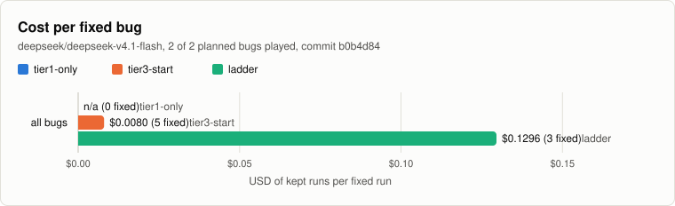

#### Time to page and time to fix

| config      | fixed n | fix p50 | fix p90 | paged n | page p50 | page p90 |
| ----------- | ------- | ------- | ------- | ------- | -------- | -------- |
| tier1-only  | 0       | n/a     | n/a     | 5       | 445s     | 505s     |
| tier3-start | 5       | 27s     | 146s    | 0       | n/a      | n/a      |
| ladder      | 3       | 822s    | 1043s   | 0       | n/a      | n/a      |

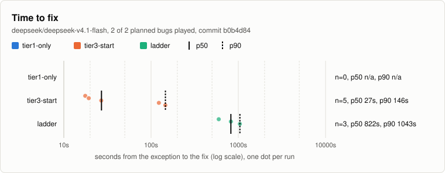

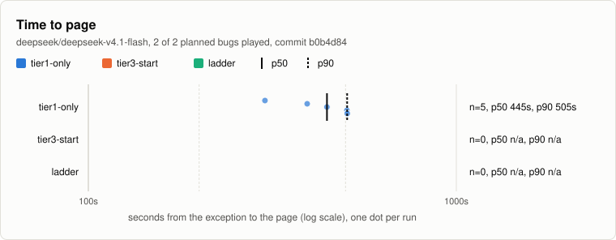

tier3-start's fixes took a median of 27 seconds. The ladder's took 822, nearly all of it
spent at Tier 1 and Tier 2 before the climb; its Tier 3 attempts took 15 to 173 seconds.

#### False escalations

There were none, and no false pages. Every ladder run that climbed failed the check at the
tiers below.

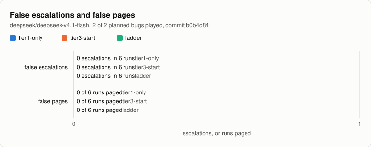

#### Unsafe attempts

Refused `execute()` calls per 100 steps, by the tier the attempt ran at:

| tier | tier1-only   | tier3-start | ladder       |
| ---- | ------------ | ----------- | ------------ |
| 1    | 6.0 (13/218) | n/a         | 7.6 (17/224) |
| 2    | n/a          | n/a         | 6.5 (12/185) |
| 3    | n/a          | 8.0 (4/50)  | 0.0 (0/35)   |

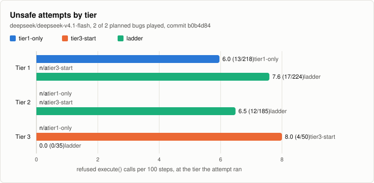

The Tier 3 attempts here are short, 50 and 35 steps in all, so one refusal moves their rate
by 2 to 3 points. The Tier 1 and Tier 2 rates are close to dev's.

#### Where the ladder landed

| scenario                           | ladder     | tier3-start | ladder misses ended at                   |
| ---------------------------------- | ---------- | ----------- | ---------------------------------------- |
| 029-shipping-override-out-of-range | 0.00 (0/3) | 1.00 (3/3)  | T2 submitted, T2 submitted, T1 submitted |

030 is left out of this table because the ladder fixed it at least as often as tier3-start
did (3 of 3 against 2 of 3).

#### What the ops set adds

On the dev and held-out code bugs the ladder matched tier3-start mostly because it rarely had
to climb. The ops bugs are the first the lower tiers can't fix, so climbing decides the
result, and the set shows both sides of it. When the lower tiers run out of steps, the
ladder climbs and fixes the bug (030, 3 of 3). When a lower tier submits a plausible code
patch, the ladder stops there (029, 0 of 3). The ladder misses the 0.8 bar on this set (0.60
x tier3-start), and the whole miss is 029. Two bugs and 18 runs can't carry a firm rate, but
they put a number on the risk dev only hinted at: the ladder's escalation trigger, as it was
in this run, didn't look at whether the submitted fix worked. Confidence escalation came
after this run and the set wasn't played again with it. The score reads the tests and checks
the agent ran, and the 029 patches came with a test, so it may not have caught them either.

### Confidence calibration (dev)

[Amendment 5](eval-prereg.md) calibrated the confidence threshold on dev bugs on 2026-11-23,
on `deepseek/deepseek-v4.1-flash` at the frozen limits. Unlike every set above, these runs
played with confidence escalation on: a submitted fix that scored under its tier's threshold
escalated, or paged at the config's last tier. The held-out set was not read or run, and 024
was not run.

Phase 1, at commit `45daa76` with the threshold at 0.3 at every tier, played tier1-only and
tier3-start 3 times on the 18 dev code scenarios, and 3 times on the two dev ops scenarios,
029 and 030, against a local compose demo app with `POSTHOG_KEY` unset. That is 120 runs in
four files:

- `eval/results/2026-11-23T12-19-13Z-tier1-only.json` (code scenarios)
- `eval/results/2026-11-23T12-19-23Z-tier1-only.json` (029 and 030)
- `eval/results/2026-11-23T12-59-55Z-tier3-start.json` (029 and 030)
- `eval/results/2026-11-23T14-18-37Z-tier3-start.json` (code scenarios)

Each submitted attempt records its score and the score's parts, and `check.sh` runs on every
attempt whatever the score. The agent never sees its score, so one recorded score says what
any threshold would have done with that attempt. The tables below are the confidence section
of `pnpm eval:tune` on the four files (#182). A code fix is a submit whose score has
`liveAfterChange` null. Ops-only fixes score 0 or 1 on the live app and are shown apart.

#### Tier 1

Scored code fixes: 48 (47 passed, 1 failed), all from tier1-only. Escalation reasons as
played: `low_confidence` 1, `budget_exhausted` 6.

| score | passed | failed |
| ----- | ------ | ------ |
| 0     | 1      | 0      |
| 0.3   | 2      | 0      |
| 0.5   | 2      | 0      |
| 0.7   | 5      | 1      |
| 0.8   | 3      | 0      |
| 1     | 34     | 0      |

| part         | passed (n = 47) | failed (n = 1) |
| ------------ | --------------- | -------------- |
| changes code | 47              | 1              |
| tests pass   | 44              | 1              |
| checks pass  | 39              | 0              |
| reproduced   | 39              | 1              |

| threshold | false escalations | wrong patches caught | allowed |
| --------- | ----------------- | -------------------- | ------- |
| 0.2       | 1 of 47           | 0 of 1               | no      |
| 0.3       | 1 of 47           | 0 of 1               | no      |
| 0.5       | 3 of 47           | 0 of 1               | no      |
| 0.7       | 5 of 47           | 0 of 1               | no      |
| 0.8       | 10 of 47          | 1 of 1               | no      |
| 1         | 13 of 47          | 1 of 1               | no      |

The one failing fix is tier1-only's 029 #3. On an ops bug, the agent wrote a code patch that
caps the setting, with a test, as the ladder did on the ops set. It saw the failure first and
its test passed, so it scored 0.7, above 5 of the 47 passing fixes. Only a threshold of 0.8
or more catches it, and 0.8 also escalates 10 passing fixes. The passing fix that scored 0 is
005 #2: it submitted without a test or check after its last edit, and its patch passed the
check anyway. At 0.3 it paged a person with a working patch.

#### Tier 3

Scored code fixes: 50, all passed, all from tier3-start. Ops-only fixes: 6. Escalation
reasons as played: `low_confidence` 4, `budget_exhausted` 1.

| score | passed | failed |
| ----- | ------ | ------ |
| 0.2   | 4      | 0      |
| 0.3   | 1      | 0      |
| 0.5   | 2      | 0      |
| 0.7   | 14     | 0      |
| 0.8   | 4      | 0      |
| 1     | 25     | 0      |

| part         | passed (n = 50) | failed (n = 0) |
| ------------ | --------------- | -------------- |
| changes code | 50              | 0              |
| tests pass   | 44              | 0              |
| checks pass  | 31              | 0              |
| reproduced   | 44              | 0              |

| threshold | false escalations | wrong patches caught | allowed |
| --------- | ----------------- | -------------------- | ------- |
| 0.2       | 0 of 50           | 0 of 0               | yes     |
| 0.3       | 4 of 50           | 0 of 0               | no      |
| 0.5       | 5 of 50           | 0 of 0               | no      |
| 0.7       | 7 of 50           | 0 of 0               | no      |
| 0.8       | 21 of 50          | 0 of 0               | no      |
| 1         | 25 of 50          | 0 of 0               | no      |

| live after change (score) | passed | failed |
| ------------------------- | ------ | ------ |
| yes (1)                   | 6      | 0      |
| no (0)                    | 0      | 0      |

The four fixes at 0.2 (008 #2, 008 #3, 018 #1, 019 #3) each saw the bug fail, then submitted
with no test or check passing after the last edit. At 0.3 each paged a person with a working
patch. A healthy restart followed the last change of every ops-only fix, so each scored 1,
and each passed.

#### The pick

The rule picks 0.2 at every tier, and #193 set `CONFIDENCE_THRESHOLD` to it.

- Tier 1: with 47 passing fixes the cap allows no false escalation, and 005 #2 is under every
  candidate, so none is allowed. The rule's fallback gives the lowest, 0.2, and flags the
  scorer for giving a working fix a 0.
- Tier 2 takes Tier 1's value, since no single-tier config plays it.
- Tier 3: 0.2 is the one allowed candidate. It escalates no passing fix; 0.3 escalates four.

At 0.2 a code fix escalates only when it scores 0: it changed no code, or nothing passed
after its last edit and no test failed before its first code edit. On these runs that is one
fix, and it worked. So on this data the threshold stops sending working fixes up a tier, but
it catches no wrong patch. The one wrong patch scored like a good one, as #174 expected of a
patch that brings its own test. The weights didn't change: the amendment fixed them, and one
failing fix can't fit three weights.

Phase 1's single-tier configs paged instead of escalating, so they also show what confidence
escalation at 0.3 cost in fix rate. `pnpm eval:report` on the two code files gives 0.85
(46/54) for both tier1-only and tier3-start, against 0.94 for each in the frozen dev run. Of
tier1-only's 8 misses, 5 ended on `format_errors`, 1 on the step limit with a passing patch,
1 was 005 #2, and 1 was 015 #2, a run that never played (below). Of tier3-start's 8, 3 ended
on `format_errors`, 1 on the step limit with a passing patch, and 4 were the low scores
above. At 0.2 those four would have landed; 005 #2, at 0, would still page.

#### Phase 3: the ladder at 0.2

Before phase 3 the amendment projects its cost from phase 1, which used $1.08 of the key's
usage. The ladder code file projected to $0.40 (the tier1-only code file's $0.38, times 1.07
for the 2 of its 54 runs that 0.2 would escalate) and the ladder ops file to $0.41 ($0.39
times $1.08 / $1.03). Both together, and the code file at 1 run per bug with the ops file,
pass $1.40, so by the rule phase 3 played only the ops file. The ops file alone projected
past $1.40 too, but it cost less than projected and the watchdog never paused it. It played
the ladder on 029 and 030, 3 runs each, at commit `7fdf982` with the threshold at 0.2:

- `eval/results/2026-11-23T15-16-34Z-ladder.json`

`pnpm eval:report` on it beside phase 1's two ops files:

| config      | runs per bug | fix rate   | cost of kept runs | cost per fixed bug | spent incl. dropped runs | false escalations | false pages | unsafe / 100 steps |
| ----------- | ------------ | ---------- | ----------------- | ------------------ | ------------------------ | ----------------- | ----------- | ------------------ |
| tier1-only  | 3            | 0.00 (0/6) | $0.1844           | n/a                | $0.1844                  | 0                 | 0           | 8.9                |
| tier3-start | 3            | 1.00 (6/6) | $0.0126           | $0.0021            | $0.0126                  | 0                 | 0           | 11.1               |
| ladder      | 3            | 0.33 (2/6) | $0.2348           | $0.1174            | $0.2348                  | 0                 | 0           | 7.1                |

On 029 the ladder did what it did on the ops set: every run landed a code patch that caps the
setting, at Tier 1 (#1, #2) or at Tier 2 (#3, after running out of steps at Tier 1). Each of
the three scored 1: it saw the failure, its own test passed, and a typecheck or lint passed.
No threshold up to 1 would have stopped them. On 030 every run ran out of steps at Tier 1 and
Tier 2 and climbed. Two fixed the bug at Tier 3, and one paged when its Tier 3 replies stopped
parsing (`format_errors`). Phase 1's tier3-start fixed all six. These are 6 runs on 2 bugs,
and the ladder's miss on 029 is the one it had before confidence escalation.

#### Runs that ended on a limit

No attempt hit the cost or time limit. These ran out of steps (`budget_exhausted` in the
daemon):

- tier1-only, code: 019 #2, after 448 s, with a patch that passed (a false page).
- tier1-only, ops: 5 of 6 (029 #1 and #2, 030 #1 to #3). Tier 1 can't change the live app, as
  on the ops set.
- tier3-start, code: 014 #1, after 189 s, with a patch that passed (a false page).
- ladder, ops: all three 030 runs at Tier 1 and Tier 2, and 029 #3 at Tier 1, each with a
  patch that failed, so each climbed.

#### Interruptions, load and spend

- The tier1-only code file stopped twice and was resumed from its checkpoint at the same
  commit. At 12:50 UTC a model call (004 #2) timed out on the network, and the runner stopped
  on its own (`stoppedForProvider`). The first resume played on. At 13:19 UTC Docker Desktop
  shut down at its app's request, not this run's, and took every container with it. Two
  attempts lost their diff, three couldn't start a sandbox, and two runs didn't start. Once
  Docker was back, a second resume played those 7 runs once, as the stop rules allow.
- 015 #2 in that file is recorded as a page with no attempt and $0. It never played: the
  provider stop reached it before its first attempt, and the runner kept it as a run instead
  of listing it in `notPlayed`. That was a runner bug: the provider error freed its money
  before it stopped the eval, so 015 #2 got a reservation and then saw the stop, and that
  exit didn't mark the run as cut short. The runner now leaves such a run out. The file is
  kept as recorded, so the tier1-only fix rate above counts it as a miss.
- The runner charges an attempt that fails before it reports a cost its whole reserved
  limit, since it can't know what was spent. The three failed sandbox starts did that, so the
  file's `spentUsd` is $1.67, while its runs' model cost is $0.38.
- The machine slept on and off between about 13:53 and 14:17 UTC, during the second resume.
  Those 7 runs' durations aren't comparable. Later runs held it awake.
- Other agents ran tests on this machine. The 1-minute load average, sampled about every 5
  minutes, ranged from 2.4 to 87 on 8 CPUs, with a median of 5.3, and was above 16 in 22% of
  the 41 samples. The highs came during phase 1. No attempt hit the 14 minute limit.
- Spend: the OpenRouter key's usage grew $1.32 over the amendment, $1.08 in phase 1 and $0.24
  in phase 3, against its $1.60 cap. The watchdog never paused a run. The five files' runs
  record $1.11 of model cost, so the key ran about 19% above it. Only this run's eval
  processes held connections to OpenRouter when that was sampled, so the gap is likely calls
  OpenRouter billed whose cost never reached the runner, such as a call that timed out or
  failed and was retried. The key has $0.62 left of its $5 limit.

#### Limits of this calibration

- Small n. 98 scored code fixes hold one failing patch, so the data shows which thresholds
  let working fixes through, not how well any threshold catches wrong ones.
- Dev bugs only, and one model.
- The held-out results above predate confidence escalation and can't be rerun: the held-out
  set has had its one run.
- The tier3-start code runs saw the ops set's Tier 3 prompt, which the frozen dev
  tier3-start runs didn't.
- The ladder played only the two ops bugs. Amendment 6 later played it on the code bugs; see
  [Ladder at 0.2 on the dev code bugs](#ladder-at-02-on-the-dev-code-bugs-amendment-6).

### Ladder at 0.2 on the dev code bugs (Amendment 6)

[Amendment 6](eval-prereg.md) played the ladder on the 18 dev code bugs on 2026-11-24, the file
Amendment 5's phase 3 had no money for: 3 runs per bug, at `fae9c77` with the threshold at 0.2
at every tier, on `deepseek/deepseek-v4.1-flash` at the frozen limits, `--concurrency 3` and no
live app, so 029 and 030 were skipped. The held-out set was not read or run, and 024 was not run.

- `eval/results/2026-11-24T00-01-32Z-ladder.json`

Beside the frozen dev ladder, it climbs on a low score and its task prompt has the command
notes (the note in the preregistration). After the run, #215 changed the agent again, so
`main` no longer plays exactly this ladder.

| file                                | fix rate     | cost of kept runs | cost per fixed bug | false escalations | false pages | unsafe / 100 steps |
| ----------------------------------- | ------------ | ----------------- | ------------------ | ----------------- | ----------- | ------------------ |
| frozen dev ladder (before scoring)  | 0.94 (51/54) | $0.4885           | $0.0096            | 2                 | 0           | 7.2                |
| Amendment 6 ladder (`fae9c77`, 0.2) | 0.78 (42/54) | $0.3393           | $0.0081            | 5                 | 1           | 5.5                |

The Amendment 6 row is `pnpm eval:report` on the file. Runs landed at Tier 1 41 times, at
Tier 2 once and never at Tier 3, and 12 paged. No run errored or went unplayed, and no attempt
ended on `model_error`.

#### No wrong patch, one climb on a low score

All 43 submitted patches (42 at Tier 1, one at Tier 2) passed `check.sh`. The frozen ladder's
wrong patches on 013 and 014 didn't come back: each was fixed at Tier 1 in all 3 runs. With
no failing fix in the file, it can't say whether the score would catch one.

One working fix climbed on its score. 011 #3's Tier 1 patch passed `check.sh` but scored 0:
it changed code, but no test, typecheck or lint passed after its last edit and no test failed
before its first. Tier 2 fixed the bug again with a score of 0.5. That is 1 false escalation in
42 passing Tier 1 fixes, more than Amendment 5's rule allows (1 in 50), so `pnpm eval:tune` on
the file flags the scorer for scoring a passing fix 0, as phase 1 did. Tier 1's scores:

| score | passed | failed |
| ----- | ------ | ------ |
| 0     | 1      | 0      |
| 0.3   | 1      | 0      |
| 0.7   | 10     | 0      |
| 0.8   | 4      | 0      |
| 1     | 26     | 0      |

#### Replies that stopped parsing

10 of the 12 misses ended at some tier on `format_errors`: the model's replies stopped parsing
as actions three times in a row. 8 were at Tier 1, 7 of those within 19 seconds and 5 steps of
the start. The other 2 were at Tier 2, after Tier 1 ran out of steps or time. The frozen dev
ladder had 1 `format_errors` attempt in 54 runs. Amendment 5's phase 1, at `45daa76` before
the command notes, had 5 in tier1-only and 3 in tier3-start. The rise began before the notes,
so they are not its only cause. The results files don't keep the replies, so they can't say
what the model sent.

#### The machine slept

At 00:48:47 UTC, 47 minutes in, the Mac went into clamshell sleep on battery. The run moved
only in short dark wakes until it ended at 01:42; `caffeinate -i` doesn't stop clamshell
sleep. Three round-3 runs were in flight through it: 019 #3, 026 #3 and 028 #3. Their Tier 1
attempts ran 1,340 to 1,521 seconds against the 840 second limit, as a process frozen across
sleep does, since the limit is checked between steps. They hold all 7 `time_limit` attempts,
3 of the 5 false escalations and the false page (028 #3, whose Tier 3 patch passed). These
outcomes say nothing about the agent, but the amendment has no rule to play them again, so
they stay in the file and in the fix rate. Leaving them out, a number the amendment didn't
set, the ladder fixed 42 of 51. Round 3's durations aren't comparable with rounds 1 and 2.

The fifth false escalation is 019 #1, whose Tier 1 ran out of steps after 573 seconds with a
patch that passed. Its Tier 2 then ended on format errors.

#### Load and spend

- The 1-minute load average, sampled every 5 minutes while the machine was awake, ranged from
  5.1 to 121 on 8 CPUs, with a median of 21.6 over 11 samples.
- The OpenRouter key's usage grew $0.3574 over the run, against the $0.50 cap. The file's runs
  record $0.3393 of model cost, so the key ran about 5% above it. The watchdog never paused.
  The key has $0.24 left of its $5 limit.

#### Limits of this run

- 54 runs on 18 bugs, one model, dev bugs only.
- No failing fix, so the score's catch rate is still untested on code bugs.
- The sleep cut into round 3, and the load was high throughout.
- The format errors' cause is unknown, because the replies aren't kept.
